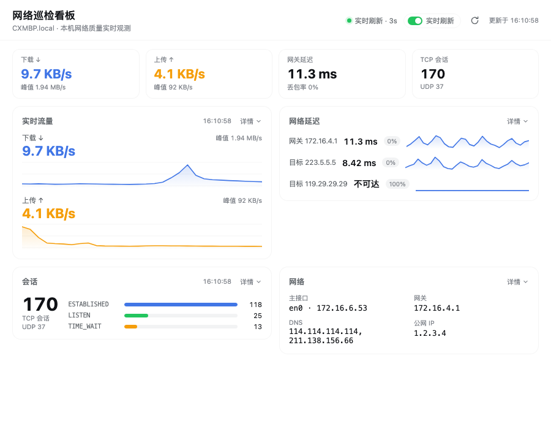
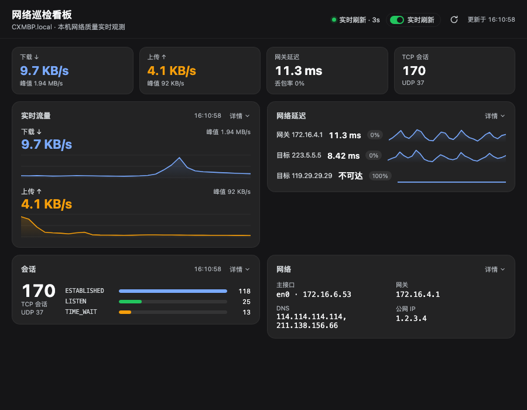
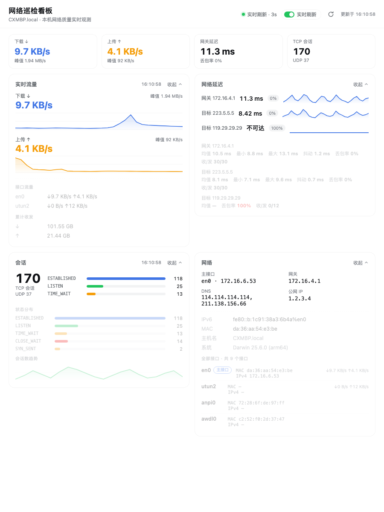

# dsh-net-dashboard

A **live network inspection dashboard** in the DeepSeek Harness sidebar: interfaces and IP/MAC, traffic rates, TCP/UDP sessions, and latency curves, all read from this machine at request time and refreshed every 3 seconds.

English | [中文](README.zh.md)



## What it does

The panel sits under the built-in sidebar rows and shows the current machine's network quality. It is key-first: a KPI strip and four cards, each collapsed to its essentials with a **详情 (Details)** disclosure.

- **KPI strip** — download rate, upload rate, gateway latency and TCP session count, always visible.
- **Live traffic** — aggregate download/upload rates (loopback excluded) with rolling curves and peaks. *Details* adds per-interface rates and cumulative in/out counters.
- **Latency** — one compact row per target: current value, loss chip and a 1-second-resolution mini curve. The default gateway is always followed; a public target is configurable. *Details* adds average / min / max / jitter / loss / received-sent statistics.
- **Sessions** — TCP session total, UDP socket count and the top state bars. *Details* adds the full TCP state breakdown and a session-count trend.
- **Network** — primary interface with IPv4, gateway, DNS resolvers and public IP at a glance. *Details* adds IPv6, MAC, Wi-Fi facts, hostname, OS version and a full interface table with live per-interface rates.

| Dark theme | Expanded details |
| --- | --- |
|  |  |

## Install

```sh
dsh plugin --profile desktop add "github:foreee/dsh-net-dashboard"
```

Use `--profile web` for the browser profile. The Web **Plugins** page and the `plugin_manager` tool accept the same address. The plugin ships plain JavaScript — no build step, no dependencies.

## How it works

The host half (`lib/index.js`) mounts one loopback-only route, `GET /api/net-dashboard/snapshot`:

- Each request runs `ifconfig`, `route`, `netstat` and `scutil --dns` (all bounded), plus `ipconfig getsummary` for Wi-Fi facts.
- Traffic rates come from diffing `netstat -ib` byte counters against the previous sample held in memory.
- Latency is fed by persistent `ping -i 1` child processes (one per target, restarted on failure, stopped with the plugin) into a rolling window; the route only reads that window, so a 3-second poll never spawns command storms.
- The public IP lookup is cached for 10 minutes and can be disabled.

The browser half (`lib/client.js`) polls the snapshot every 3 seconds (toggleable, persisted in `localStorage`), keeps its own rolling history for the traffic and session curves, and draws every chart as inline SVG — no chart dependency. Colors use the shell theme tokens, so light and dark themes both work.

## Routes

| Route | Method | Purpose |
| --- | --- | --- |
| `api/net-dashboard/snapshot` | GET | one full snapshot: interfaces, primary facts, traffic, sessions, latency |

The route sits behind a loopback-only trust fence (loopback socket **and** loopback Host header, same-origin markers enforced); paired remote devices are rejected.

## Configuration

| Field | Default | Meaning |
| --- | --- | --- |
| `enabled` | `true` | set `false` to mount nothing |
| `pingTargets` | `["223.5.5.5"]` | extra latency targets; the default gateway is always followed |
| `publicIp` | `true` | enable the cached public IP lookup |

## Requirements and limitations

- The collector commands and parsers target **macOS**.
- Without Location permission macOS hides Wi-Fi SSID/RSSI; those rows are simply omitted.
- Traffic rates need two snapshots to materialize, so the first poll shows `—`.

## Development

```sh
node --test test/*.test.js   # parser, trust-fence and loopback-guard tests
node --check lib/index.js && node --check lib/client.js
```

## License

MIT
