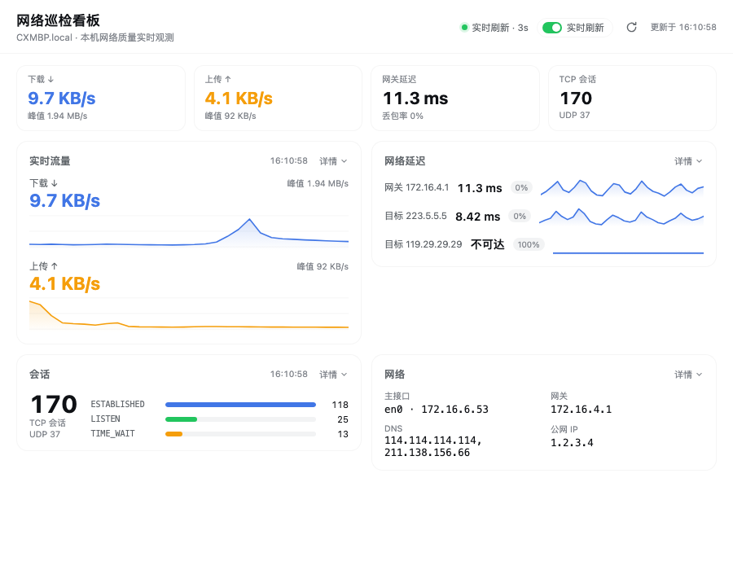
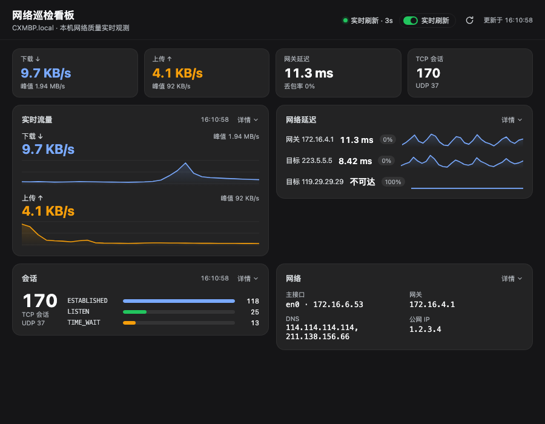
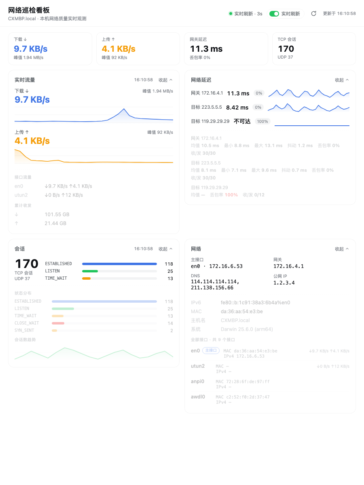

# dsh-net-dashboard

DeepSeek Harness 侧边栏里的**实时网络巡检看板**：接口与 IP/MAC、流量速率、TCP/UDP 会话、延迟曲线，全部在请求时刻从本机读取，默认每 3 秒刷新一次。

[English](README.md) | 中文



## 功能

面板位于侧边栏内置入口下方，呈现当前机器的网络质量。默认只展示关键信息：一条 KPI 指标条 + 四张卡片，每张卡片都能通过 **详情** 手动展开。

- **KPI 指标条**：下载速率、上传速率、网关延迟、TCP 会话数，始终可见。
- **实时流量**：总下载/上传速率（排除本地环回）与滚动曲线、峰值。*详情* 展开逐接口速率与累计收发量。
- **网络延迟**：每个探测目标一行——当前值、丢包标记与 1 秒分辨率迷你曲线；默认网关始终被跟踪，公共目标可配置。*详情* 展开均值/最小/最大/抖动/丢包/收发统计。
- **会话**：TCP 会话总数、UDP 套接字数与前三大状态条形。*详情* 展开完整 TCP 状态分布与会话数趋势。
- **网络**：主接口 IPv4、网关、DNS、公网 IP 一眼可见。*详情* 展开 IPv6、MAC、Wi-Fi、主机名、系统版本与全部接口列表（含逐接口实时速率）。

| 暗色主题 | 展开明细 |
| --- | --- |
|  |  |

## 安装

```sh
dsh plugin --profile desktop add "github:foreee/dsh-net-dashboard"
```

Web 端 profile 用 `--profile web`。Web 的**插件**页与 `plugin_manager` 工具接受同一地址。插件为纯 JavaScript，无需构建、无运行时依赖。

## 工作原理

宿主半部（`lib/index.js`）只挂载一个 loopback-only 路由 `GET /api/net-dashboard/snapshot`：

- 每次请求执行 `ifconfig`、`route`、`netstat`、`scutil --dns`（全部限时），Wi-Fi 信息来自 `ipconfig getsummary`。
- 流量速率由 `netstat -ib` 的字节计数器与内存中上一次采样做差得到。
- 延迟由常驻 `ping -i 1` 子进程喂入内存滚动窗口（每个目标一个，异常自动重启，随插件停止），路由只读该窗口 —— 3 秒轮询不会产生命令风暴。
- 公网 IP 查询缓存 10 分钟，可关闭。

浏览器半部（`lib/client.js`）每 3 秒拉取一次快照（可开关，选择持久化在 `localStorage`），自维护流量与会话曲线的滚动历史，全部图表为内联 SVG —— 零图表依赖。颜色跟随应用主题 token，亮/暗主题均适配。

## 路由

| 路由 | 方法 | 用途 |
| --- | --- | --- |
| `api/net-dashboard/snapshot` | GET | 一次完整快照：接口、主连接信息、流量、会话、延迟 |

路由带 loopback-only 信任围栏（socket 与 Host 头都必须是环回，且校验同源标记）；配对远端设备会被拒绝。

## 配置

| 字段 | 默认 | 含义 |
| --- | --- | --- |
| `enabled` | `true` | 置 `false` 则什么都不挂载 |
| `pingTargets` | `["223.5.5.5"]` | 额外延迟目标；默认网关始终被跟踪 |
| `publicIp` | `true` | 启用缓存式公网 IP 查询 |

## 环境与限制

- 采集命令与解析器面向 **macOS**。
- 未授予定位权限时 macOS 隐藏 Wi-Fi SSID/RSSI，对应行会自动省略。
- 流量速率需要两次快照做差，因此首次轮询显示 `—`。

## 开发

```sh
node --test test/*.test.js   # 解析器、信任围栏与环回判断测试
node --check lib/index.js && node --check lib/client.js
```

## 许可

MIT
